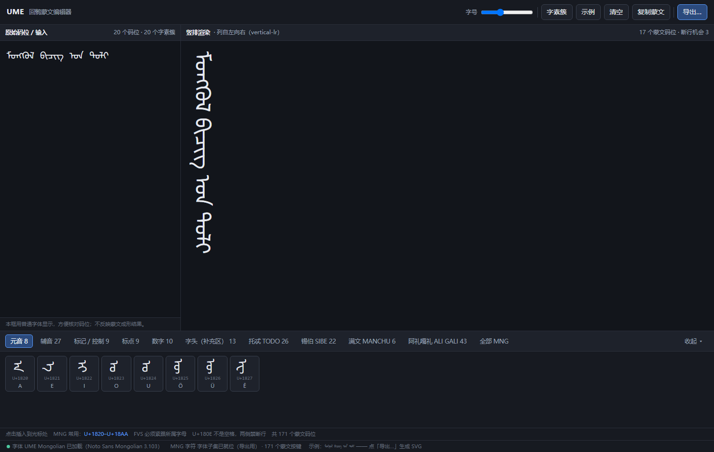

# UME 字体字符分布分析报告

**项目**：UME — Uyghur-Mongolian Editor / 回鹘蒙文编辑器
**分析对象**：`font/NotoSansMongolian-Regular.ttf`
**分析日期**：2025
**分析工具**：`tools/analyze_font.py`、`tools/analyze_glyphs.py`、`tools/chart_coverage.py`

---

## 1. 字体基本信息

| 项目 | 值 |
|---|---|
| 文件名 | NotoSansMongolian-Regular.ttf |
| 文件大小 | 388,168 字节（379.1 KB） |
| 字族 / 样式 | Noto Sans Mongolian / Regular |
| 版本 | Version 3.103（`fontc 1.0.0; tilvisan v0.1.1` 构建） |
| PostScript 名 | NotoSansMongolian-Regular |
| 版权 | Copyright 2023 The Noto Project Authors |
| 许可 | SIL Open Font License 1.1（可自由嵌入、修改、再发布） |
| 厂商 / 设计 | Monotype Imaging Inc. / Monotype Design Team |
| 轮廓格式 | TrueType (`glyf`)，sfntVersion `0x00010000` |
| em 单位 | 1000 |
| 字重 / 字宽 | 400 (Regular) / 5 (Medium) |
| 字形总数 | **3,715** |
| Unicode 码位数 | **517** |
| 数据表 | 17 个：GDEF, GPOS, GSUB, OS/2, cmap, cvt, fpgm, gasp, glyf, head, hhea, hmtx, loca, maxp, name, post, prep |

### 度量（竖排排版的参考基线）

| 度量 | 值 |
|---|---|
| hhea ascender / descender / lineGap | 1457 / −293 / 0 |
| OS/2 winAscent / winDescent | 1642 / 388 |
| OS/2 xHeight / capHeight | 500 / 700 |
| 横向 advance 范围 | 0 – 1596（552 种不同取值） |
| advanceWidthMax | 1596 |

> **注意**：字体**不含 `vhea` / `vmtx` 表**。蒙文为竖排书写，但该字体未提供竖排度量，因此编辑器需自行做 90° 旋转排版（横排坐标系 → 竖排显示），不能依赖字体的竖排度量。

---

## 2. 字符分布总览

字体共收录 **517 个 Unicode 码位**，分为两大部分：

```
517 码位
├── 171  蒙文字符（33.1%）  ← 字体核心
│   ├── 158  U+1800–U+18AF  Mongolian（蒙文主区段）
│   └──  13  U+11660–U+1167F Mongolian Supplement（蒙文补充区段）
└── 346  非蒙文（66.9%）   ← 编辑器界面与混排支撑
    ├── 268  Basic Latin + Latin-1 + Latin Ext-A/B（西文）
    ├──  37  标点（常用标点 17 + CJK 标点 11 + 其它）
    ├──  14  组合附加符号 U+0300–U+036F
    ├──   9  间距修饰符 U+02B0–U+02FF
    └──  18  其它（货币、数学、几何、半角全角等）
```

### 按 Unicode 区段分布

| 区段 | 码位数 | 说明 |
|---|---:|---|
| **Mongolian** U+1800–U+18AF | **158** | 蒙文核心：字母、标点、数字、变体选择符 |
| **Mongolian Supplement** U+11660–U+1167F | **13** | 各类装饰性字头（birga 系列） |
| Basic Latin U+0000–U+007F | 95 | ASCII 可打印字符 **全覆盖（95/95）** |
| Latin Extended-A U+0100–U+017F | 89 | 欧洲语言扩展 |
| Latin-1 Supplement U+0080–U+00FF | 84 | |
| General Punctuation U+2000–U+206F | 17 | |
| Combining Diacritical Marks U+0300–U+036F | 14 | |
| CJK Symbols and Punctuation U+3000–U+303F | 11 | 中日韩标点，含 `.vert` 竖排变体 |
| Spacing Modifier Letters U+02B0–U+02FF | 9 | |
| Latin Extended Additional U+1E00–U+1EFF | 9 | |
| Halfwidth and Fullwidth Forms U+FF00–U+FFEF | 9 | 全角标点，含 `.vert` 变体 |
| Latin Extended-B U+0180–U+024F | 5 | |
| Currency / Letterlike / Math / Geometric | 各 1 | |

> **工程提示**：ASCII 可打印字符 95/95 全覆盖，说明该字体**可以单独承担编辑器界面文本**（菜单、按钮、快捷键提示）与蒙文-西文混排，无需额外回退字体。

---

## 3. 蒙文主区段 U+1800–U+18AF 详解

### 3.1 覆盖率：100%

| 指标 | 值 |
|---|---:|
| Unicode 已分配码位（Unicode 15.0.0） | 158 |
| 字体已收录 | **158** |
| **覆盖率** | **100.0%** |
| 未收录 | 无 |

Unicode 15.0.0 该区段内 176 个码位中有 18 个尚未分配（U+181A–U+181F、U+1879–U+187F、U+18AB–U+18AF），因此 158 即为该区段的完整覆盖。

### 3.2 字符构成

| 类别 | 数量 | 码位范围 |
|---|---:|---|
| 字母（Lo / Lm） | **129** | U+1820–U+18AA |
| 数字（Nd） | **10** | U+1810–U+1819 |
| 标点（Po / Pd） | **10** | U+1800–U+180A |
| 组合标记（Mn） | **7** | U+180B–U+180D, U+180F, U+1885, U+1886, U+18A9 |
| 格式字符（Cf） | **1** | U+180E MONGOLIAN VOWEL SEPARATOR |
| 修饰字母（Lm） | （含于字母内） | U+1843 |

### 3.3 按文字体系的字母分组

| 分组 | 码位 | 数量 | 用途 |
|---|---|---:|---|
| 传统蒙文（Khalkha 基础） | U+1820–U+1842 | 35 | 回鹘蒙文核心字母 |
| TODO（托忒蒙文） | U+1843–U+185C | 26 | 卫拉特方言 |
| SIBE（锡伯文） | U+185D–U+1872 | 22 | 锡伯语 |
| MANCHU（满文） | U+1873–U+1877 | 5 | 满文 |
| 附加/扩展字母 | U+1878 | 1 | CHA WITH TWO DOTS |
| ALI GALI（阿礼嘎礼，梵藏转写） | U+1880–U+18A5, U+18A6–U+18AA | 39 | 梵文、藏文音译 |

> **编辑器提示**：字体完整覆盖**蒙、托忒、锡伯、满**四种文字体系及阿礼嘎礼转写，可作为多文种蒙文编辑器的唯一正文字体。

### 3.4 标点与数字

| 码位 | 字符 | 名称 | advance |
|---|---|---|---:|
| U+1800 | ᠀ | BIRGA（字头标志） | 614 |
| U+1801 | ᠁ | ELLIPSIS（省略号） | 1086 |
| U+1802 | ᠂ | COMMA（逗号） | 324 |
| U+1803 | ᠃ | FULL STOP（句号） | 578 |
| U+1804 | ᠄ | COLON（冒号） | 324 |
| U+1805 | ᠅ | FOUR DOTS（四点） | 638 |
| U+1806 | ᠆ | TODO SOFT HYPHEN（托忒连字符） | 630 |
| U+1807 | ᠇ | SIBE SYLLABLE BOUNDARY MARKER | 284 |
| U+1808 | ᠈ | MANCHU COMMA（满文逗号） | 372 |
| U+1809 | ᠉ | MANCHU FULL STOP（满文句号） | 592 |
| U+180A | ᠊ | NIRUGU（词干连接符） | 168 |
| U+1810–U+1819 | ᠐–᠙ | 蒙文数字 0–9 | 534–875 |

### 3.5 自由变体选择符（FVS）

字体支持全部 4 个变体选择符，用于区分蒙文中形同音异的字母：

| 码位 | 名称 | 字形名 |
|---|---|---|
| U+180B | FREE VARIATION SELECTOR ONE | uni180B |
| U+180C | FREE VARIATION SELECTOR TWO | uni180C |
| U+180D | FREE VARIATION SELECTOR THREE | uni180D |
| U+180F | FREE VARIATION SELECTOR FOUR | fvs4 |

> **编辑器提示**：FVS 是蒙文正确显示的关键。输入法/编辑器需允许用户在字母后插入 FVS1–FVS4，并交由排版引擎（HarfBuzz 等）结合 `ccmp` 特性完成区分。U+180E（VOWEL SEPARATOR）为格式字符，advance = 770，但视觉上不产生笔画。

### 3.6 蒙文补充区段 U+11660–U+1167F（13 个）

字体收录 13 个装饰性字头，均用于文档开篇的装饰：

`U+11660` BIRGA WITH ORNAMENT、`U+11661` ROTATED BIRGA、`U+11662` DOUBLE BIRGA WITH ORNAMENT、`U+11663` TRIPLE BIRGA WITH ORNAMENT、`U+11664` BIRGA WITH DOUBLE ORNAMENT、`U+11665` ROTATED BIRGA WITH ORNAMENT、`U+11666` ROTATED BIRGA WITH DOUBLE ORNAMENT、`U+11667` INVERTED BIRGA、`U+11668` INVERTED BIRGA WITH DOUBLE ORNAMENT、`U+11669` SWIRL BIRGA、`U+1166A` SWIRL BIRGA WITH ORNAMENT、`U+1166B` SWIRL BIRGA WITH DOUBLE ORNAMENT、`U+1166C` TURNED SWIRL BIRGA WITH DOUBLE ORNAMENT

---

## 4. 字形分布：3,715 个字形都是什么

这是本字体最重要的结构特征：**517 个码位对应 3,715 个字形**，多出的 3,198 个字形全部是上下文形位与连字。

### 4.1 可达性

| 指标 | 数量 | 占比 |
|---|---:|---:|
| 被 `cmap` 直接引用的字形 | 517 | 13.9% |
| **仅由 GSUB 间接产生的字形** | **3,198** | **86.1%** |

> **关键结论**：**86.1% 的字形无法直接寻址**，必须由排版引擎的 OpenType 特性生成。若编辑器不支持上下文替换，蒙文将显示为孤立的单字形（错误形态）。

### 4.2 按形位后缀分布

| 形位后缀 | 字形数 | 占比 | 含义 |
|---|---:|---:|---|
| `.medi` | 927 | 25.0% | 词中形 |
| `.init` | 812 | 21.9% | 词首形 |
| `.fina` | 687 | 18.5% | 词尾形 |
| （无后缀/基础字形） | 520 | 14.0% | 标点、数字、基字形 |
| `.isol` | 509 | 13.7% | 单独形 |
| `._isol` | 136 | 3.7% | 后接元音时的独立形 |
| `._fina` | 58 | 1.6% | 后接元音的词尾形 |
| `.vert` | 25 | 0.7% | 竖排标点变体 |
| 其它（`ignored`, `mvs`, `fvs1`…） | 41 | 1.1% | 控制/特殊字形 |

**四种形位合计 2,935 个字形（79.0%）**——蒙文的"词首/词中/词尾/单独"四态是字形膨胀的主因。

### 4.3 音节连字体系（本字体的核心设计）

该字体**未采用"单字母 × 4 形位"的简单方案**，而是采用**音节级连字**：

- 涉及 `uXXXX.<形位>` 命名的字形共 **712 个**，来自 **127 个蒙文码位**
- 每个码位的形位数分布：4 形（56 个码位）、7 形（13 个）、9 形（8 个）、5 形（22 个），最多达 16 形

例如：

| 码位 | 字母 | 形位数 | 形位清单 |
|---|---|---:|---|
| U+1820 | A | 9 | `A.isol` `A.init` `A.medi` `A.fina` `AA.isol` `AA.init` `AA.medi` `Aa.isol` `Aa.fina` |
| U+1828 | NA | 13 | `N.isol` `N.init` `N.medi` `N.fina` `N.init._isol` `A.init._isol` `A.medi` `A.fina` `N2.init` `N2.init._isol` `Nx.medi` `Nx.fina` |
| U+1823 | O | 6 | `O.medi` `O.fina` `AO.isol` `AO.init` `AO.medi` `U.fina` |

> **解读**：`AA`、`Aa`、`AO`、`AI` 等是**"辅音 + 元音"的音节合体字形**。例如 U+1820 (A) 在词首与后续元音组合时使用 `AA.init`。这说明该字体的设计策略是**用预组合音节字形保证连笔质量**，而非纯靠 GPOS 定位。

### 4.4 连字（Ligature）统计

| 指标 | 值 |
|---|---:|
| GSUB type 4 连字 lookup | 13 |
| **连字总数** | **1,944** |

连字主要用于两类场景：

1. **元音分隔符展开**：`mvs.wide + mvs.wide → uni180E`（U+180E 的显示实现）
2. **"辅音 + 阴性/阳性元音标记"合体**：`u1820.A.fina + marker.masculine → u1820.A.fina`，即通过 `marker.masculine` / `marker.feminine` 字形区分阴阳性元音——这是蒙文正字法的关键机制。

---

## 5. OpenType 排版特性

### 5.1 GSUB（字形替换）

| 指标 | 值 |
|---|---:|
| 脚本 | `DFLT`, `mong`, `latn`, `cyrl`, `grek` |
| lookup 总数 | **202** |
| 替换条目总数 | **2,520** |

**lookup 类型分布：**

| 类型 | 名称 | 数量 |
|---|---|---:|
| 1 | Single 单字替换 | 113 |
| 2 | Multiple 一字拆多 | 10 |
| 4 | Ligature 连字合并 | 13 |
| 5 | Context 上下文 | 11 |
| 6 | Chaining 链式上下文 | **54** |
| 8 | ReverseChaining 反向链式 | 1 |

**特性（feature）分布：**

| 特性 | lookup 数 | 替换条目 | 用途 |
|---|---:|---:|---|
| **`rclt`** | **75** | **820** | **必需连字——蒙文形态的核心** |
| `init` | 1 | 125 | 词首形 |
| `medi` | 1 | 125 | 词中形 |
| `fina` | 1 | 124 | 词尾形 |
| `isol` | 1 | 123 | 单独形 |
| `vert` | 1 | 25 | 竖排标点变体 |
| `ccmp` | 2 | 8 | 字形组合/分解（FVS 支持） |
| `aalt` | 1 | 6 | 候选字形 |
| `locl` | 2 | 4 | 语言本地化 |
| `ordn` | 1 | 0 | 序数 |

> **编辑器关键点**：`rclt` 占全部替换条目的 **60%**（820 / 1,360）。`rclt`（Required Contextual Ligatures）是**必须默认开启**的特性，蒙文的所有连笔形态都依赖它。编辑器若使用底层排版 API，务必确保 `rclt` 处于启用状态。
>
> **口径说明**：字体里有**两条** `rclt` feature 记录（75 与 74 个 lookup，服务于不同语言系统），
> 去重后共 **75** 个 lookup。早期版本误把两条记录的 lookup 数相加得到 "149"，
> 并据此把替换条目算成 1,639 —— 该数字偏大，正确值是 75 个 lookup / 820 条替换。
> 类型构成：链式上下文（type 6）44 个、连字（type 4）12 个、上下文（type 5）11 个、
> 一字拆多（type 2）6 个、单字（type 1）1 个、反向链式（type 8）1 个。

### 5.2 `mong` 脚本的语言系统

字体在 `mong` 脚本下提供了 4 套语言系统，编辑器可通过设置语言标签切换文字体系：

| 语言标签 | 对应文字 | 启用特性 |
|---|---|---|
| `MNG ` | 传统蒙文 | aalt, ccmp, fina, init, isol, medi, ordn, rclt, vert |
| `TOD ` | 托忒蒙文 | 同上 |
| `SIB ` | 锡伯文 | 同上 |
| `MCH ` | 满文 | 同上 |

### 5.3 GPOS（字形定位）

| 指标 | 值 |
|---|---:|
| lookup 类型 | type 2 (1 个)、type 4 (1 个)、type 6 (2 个) |
| 特性 | `kern`（字距）、`mark`（标记定位）、`mkmk`（标记间定位） |

### 5.4 GDEF（字形类别）

| 类别 | 数量 |
|---|---:|
| Base 基字形 | 223 |
| Mark 标记 | 17 |
| **markGlyphSets** | **6** |

> Mark 字形（组合标记）只有 17 个，但有 6 个 mark glyph set，说明该字体通过**分类标记集 + 上下文规则**来处理变音符号的定位，而非为每个标记定义独立定位规则。

---

## 6. 结论与工程建议

### 6.1 核心结论

1. **字符覆盖完整**：蒙文主区段 U+1800–U+18AF **100% 覆盖（158/158）**，另加补充区段 13 个装饰字头，共 **171 个蒙文字符**。
2. **多文种支持**：完整支持传统蒙文、托忒蒙文、锡伯文、满文、阿礼嘎礼梵藏转写五种体系。
3. **字形高度依赖排版引擎**：**86.1%（3,198/3,715）的字形仅由 GSUB 生成**，编辑器必须具备 OpenType 上下文排版能力。
4. **音节连字设计**：字体采用"辅音+元音"预组合音节字形（712 个形位字形，127 个码位），而非简单四态方案。
5. **`rclt` 特性是生命线**：75 个 lookup、820 条替换，占全字体替换条目的 60%，必须默认开启。
   其主体是 44 个**链式上下文**（type 6）规则 —— 这正是"字形由上下文决定"的机制来源。
6. **无竖排度量**：缺 `vhea`/`vmtx`，竖排需编辑器自行旋转；字体自带 25 个 `.vert` 标点变体，应按**逆时针 90°** 取向使用（已通过字形比对验证：U+3008/3009/FF08/FF09 逆时针旋转后与字体自带 `.vert` 字形重合度 IoU 0.95~0.98，顺时针仅 0.08~0.09）。
7. **界面文本可自给**：ASCII 可打印字符 95/95 全覆盖，编辑器 UI 无需额外字体。

### 6.2 对 UME 编辑器的具体建议

| 建议 | 理由 |
|---|---|
| 排版引擎选用 **HarfBuzz** | 需完整支持 `rclt`/`ccmp`/`init`/`medi`/`fina`/`isol` 与 FVS |
| 竖排实现：**整体坐标旋转 −90°**，而非依赖 `vhea`/`vmtx` | 字体无竖排度量表 |
| 默认启用 `rclt`，禁止用户关闭 | 关闭后蒙文形态全部错误 |
| 输入法需支持插入 **FVS1–FVS4（U+180B–U+180D, U+180F）** | 区分形同音异字母的唯一手段 |
| 语言标签切换 `MNG `/`TOD `/`SIB `/`MCH ` | 字体已按文字体系分包，切换即可正确成形 |
| 数字输入需内建 **U+1810–U+1819** 映射 | 蒙文数字与 ASCII 数字字形不同 |
| 标点竖排使用 `.vert` 变体并配合 90° 旋转 | 字体仅对 25 个标点提供 `.vert` |
| 注意 `marker.masculine` / `marker.feminine` | 阴阳性元音标记通过连字实现，编辑器不应过滤这些控制字形 |

---

## 7. 蒙文 Unicode 码区 U+1800–U+18AF 专项调查

> 数据来源：**Unicode Character Database 18.0.0**（`Blocks.txt` 标注 `Blocks-18.0.0.txt`，2026-07-08），
> 已缓存于 `report/ucd/`。逐码位属性见 `report/unicode-1800-18AF.txt`，
> 编辑行为验证见 `report/unicode-mongolian-editing.txt`。

### 7.1 块边界与版本核实

| 项目 | 值 |
|---|---|
| 区段名 | **Mongolian** |
| 范围 | `U+1800..U+18AF`（正好 176 个码位，8 列 × 22 行） |
| 已分配 | **158** |
| 未分配（保留） | **18**：U+181A–U+181F、U+1879–U+187F、U+18AB–U+18AF |
| 相邻区段 | U+18B0 起为 Unified Canadian Aboriginal Syllabics Extended |

**版本核实结论**：本地 Python 的 `unicodedata` 为 Unicode 15.0.0，而抓取的 UCD 为 **18.0.0**，
两者对 U+1800–U+18AF 均给出**同样的 158 个已分配码位**。即 Unicode 16.0/17.0/18.0
**没有**在该区段新增或变更任何字符——本区段自 Unicode 14.0（新增 U+180F FVS4）以来已冻结。
因此前面"字体覆盖率 100%"的结论对最新标准依然成立。

### 7.2 属性分布

**通用类别（GC）**

| GC | 名称 | 数量 |
|---|---|---:|
| `Lo` | Other_Letter | **128** |
| `Po` | Other_Punctuation | 10 |
| `Nd` | Decimal_Number | 10 |
| `Mn` | Nonspacing_Mark | 7 |
| `Pd` | Dash_Punctuation | 1（U+1806） |
| `Cf` | Format | 1（U+180E） |
| `Lm` | Modifier_Letter | 1（U+1843 TODO LONG VOWEL SIGN） |

**Script**

| Script | 数量 | 说明 |
|---|---:|---|
| `Mongolian` | **155** | |
| `Common` | 3 | **U+1802 逗号、U+1803 句号、U+1805 四点** |

> **坑点**：U+1802 / U+1803 / U+1805 的 Script 是 **Common** 而非 Mongolian，
> 意味着按 script 做字体回退时，这三个标点可能被**回退到非蒙文字体**，导致字形风格不一致。
> 编辑器应在字体栈中显式声明蒙文字体优先，或对 Common 标点做特殊处理。

**Joining_Type（连接类型，蒙文独有模型）**

| JT | 名称 | 数量 |
|---|---|---:|
| `D` | Dual_Joining 双向连接 | **125** |
| `U` | Non_Joining 不连接 | 25 |
| `T` | Transparent 透明 | 7 |
| `C` | Join_Causing 引起连接 | **1**（U+180A NIRUGU） |

**Grapheme_Cluster_Break**

| GCB | 数量 |
|---|---:|
| `Other` | 150 |
| `Extend` | **7**（U+180B/C/D/F、U+1885、U+1886、U+18A9） |
| `Control` | **1**（U+180E） |

**Canonical_Combining_Class**：`ccc=0` 共 157 个，**`ccc=228` 仅 1 个（U+18A9 DAGALGA）**。

**关键派生属性命中的码位**

| 属性 | 数量 | 码位 |
|---|---:|---|
| `Default_Ignorable_Code_Point` | 5 | U+180B–U+180F |
| `Variation_Selector` | 4 | U+180B、U+180C、U+180D、U+180F |
| `Grapheme_Extend` | 7 | U+180B–U+180D、U+180F、U+1885、U+1886、U+18A9 |
| `Case_Ignorable` | 9 | 上述 7 个 + U+180E + U+1843 |
| `Alphabetic` | 132 | 所有字母 |
| `ID_Start` | 131 | 可作为标识符首字符 |
| `ID_Continue` | 146 | 可作为标识符后续字符 |
| `White_Space` | **0** | **无任何码位是空白字符** |
| `Deprecated` | 0 | 无 |
| `Bidi_Control` / `Join_Control` | 0 | 无 |

### 7.3 编辑行为验证（严格实现 UAX #29 / UAX #14）

**(a) 字素簇（光标移动 / 退格 / 选取的最小单位，UAX #29）**

| 输入 | 码位数 | 字素簇 | 结果 |
|---|---:|---:|---|
| 纯字母词（ᠮᠣᠩᠭᠣᠯ） | 6 | 6 | 逐码位 |
| 字母 + FVS1 在词尾 | 7 | **6** | **FVS 黏附前一字母** |
| 字母 + FVS1 夹在词中 | 7 | **6** | **FVS 黏附前一字母** |
| Baluda（U+1887+U+1885） | 2 | **1** | **组合标记黏附** |
| Dagalga（U+1889+U+18A9） | 2 | **1** | **组合标记黏附** |
| MVS（U+180E）分隔 | 12 | 12 | **不黏附，独立成簇** |

结论：
- 蒙文字母彼此**不合并**，一词 N 个字母就是 N 个光标位（与拉丁文一致）；
- **FVS1–FVS4 必须与前一字母视为一体**：光标不得停在字母与 FVS 之间，
  退格须一次删除"字母+FVS"，否则会破坏字形选择语义；
- **U+180E 是唯一会切断字素簇的蒙文控制符**（GCB=`Control`），
  且 `White_Space=0`——它**不是空格**，编辑器不能把它当空白字符做 trim/分词。

**(b) 断行机会（竖排列宽换行点，UAX #14）**

实测（已按 LB9 先把 `CM`/`ZWJ` 归并到前字符类别）：

| 输入 | 断行机会 | 说明 |
|---|---:|---|
| 纯字母词 | **0** | `AL × AL` 禁止断行（LB28） |
| 字母 + FVS + 字母 | **0** | FVS 为 `CM`，归并后仍是 `AL × AL` |
| NIRUGU 连接两词 | **0** | U+180A 为 `AL`，无断点 |
| MVS 分隔 | **0** | **U+180E 为 `GL`（不换行黏合），两侧均禁断** |
| 空格分隔 | 1 | ASCII 空格是唯一自然断点 |
| 蒙文逗号/句号后 | 1 | |
| 蒙文冒号（U+1804）前后 | 1 | `BA` 类 |
| Sibe 边界符 U+1807 | **0** | `AL` 且 `JT=D`，标点但不断行 |
| 字母 + 数字 | **0** | `AL`/`NU` 之间禁断（LB23） |

**排版要点**：蒙文字母 `LB=AL`，`AL × AL` 禁止断行，且传统蒙文**不用空格分词**，
因此**一个长词在竖排中是不可断的整体**，会整块溢出到下一列。
编辑器的竖排列宽算法必须处理"整词换列"，并为超长词提供溢出策略（缩放/强制断列/横向滚动）。

标点断行类别：

| 码位 | 标点 | LB 类 | 行为 |
|---|---|---|---|
| U+1800 | BIRGA | `AL` | 视作字母 |
| U+1801 | ELLIPSIS | `AL` | 视作字母 |
| U+1802 | COMMA | `EX` | 不得出现在**行首**（禁则） |
| U+1803 | FULL STOP | `EX` | 不得出现在**行首** |
| U+1804 | COLON | `BA` | 其后可断 |
| U+1805 | FOUR DOTS | `BA` | 其后可断 |
| U+1806 | TODO SOFT HYPHEN | `BB` | 其前可断 |
| U+1807 | SIBE BOUNDARY | `AL` | 不断行，参与连写 |
| U+1808 | MANCHU COMMA | `EX` | 不得出现在**行首** |
| U+1809 | MANCHU FULL STOP | `EX` | 不得出现在**行首** |
| U+180A | NIRUGU | `AL` | 不断行，强制连接 |

**(c) U+180E 的完整语义（易被误用）**

| 属性 | 值 | 含义 |
|---|---|---|
| GC | `Cf`（Format） | 格式字符，非空白 |
| `White_Space` | **否** | Unicode 6.3 起取消其空白属性 |
| LineBreak | **`GL`**（Glue） | 两侧**都不得**断行 |
| GCB | `Control` | 切断字素簇 |
| `Default_Ignorable` | 是 | 无形渲染 |

> 结论：U+180E 是**词内元音分隔符**，不是词间分隔符。用它替代空格做分词是错误用法。
> 编辑器应把它与该词绑定处理，不可参与 trim/分词/断行计算。

### 7.4 对 UME 编辑器的补充建议

| 建议 | 依据 |
|---|---|
| 光标与退格以**字素簇**为单位，FVS 与前一字母视为一体 | §7.3(a) |
| U+180E 不得按空白处理，不参与 trim / 分词 / 断行 | `White_Space=0`、`LB=GL` |
| 竖排换行只允许发生在空格与 `BA`/`BB` 标点处 | §7.3(b) |
| 实现"整词换列"：`AL × AL` 无断点，长词不可断 | LB28 |
| 标点禁则：`EX` 类（U+1802/1803/1808/1809）不得置于行首 | §7.3(b) |
| 对 U+1802/1803/1805（Script=Common）显式指定蒙文字体，防回退 | §7.2 |
| ID 校验可用 `ID_Start`/`ID_Continue` 判定合法标识符字符 | §7.2 |
| 无需考虑双向文本控制（`Bidi_Control=0`） | §7.2 |

---

## 8. 前端预览 `web/UME.html`

`web/UME.html` 是一个**零依赖、单文件**的蒙文编辑器预览，双击即可用 `file://` 打开
（字体经 `@font-face` 以相对路径 `../font/NotoSansMongolian-Regular.ttf` 加载，无需服务器）。



### 8.1 两种竖排引擎（可切换对照）

编辑器内置两个可切换的竖排引擎，顶栏「竖排引擎」下拉框切换，或点「两法对照」并排比较：

| 引擎 | 做法 | 说明 |
|---|---|---|
| **A** `vertical-lr` | CSS `writing-mode:vertical-lr` | 交给排版引擎做列方向排版；列自左向右 |
| **B** `rotate(90deg)` | 横排整形后把文本框整体顺时针旋转 90° | 经典做法，见 §8.2 |

两者**渲染结果完全相同**——已用像素级测量确认（同一视口区域内截图对比）：

| 指标 | 引擎 A | 引擎 B |
|---|---:|---:|
| 墨迹像素数 | **78,954** | **78,954** |
| 墨迹包围盒高度 | 1,974 px | 1,974 px |
| 列间距 | 164 px | 164 px |

墨迹像素数**逐位相同**，说明两种引擎选出的字形完全一致，只是起始 x 略有差别（B 的旋转基点）。
对照截图：`report/engine-compare-split.png`、`engine-vertical-lr.png`、`engine-rotate90.png`。

> **结论**：`vertical-lr` 与 `rotate(90deg)` 是同一个渲染结果的两条路径，二者都不“坏”。
> 需要排查渲染问题时，可以切换引擎直接对照——若两者显示不同，问题在环境而不在代码。

### 8.2 引擎 B 的几何要点（实现旋转方案时最容易踩的坑）

设文本横排时宽 `w`、高 `h`（`h` 即旋转后的「行长」）。以 `transform-origin:top left`
顺时针转 90° 后，局部点 `(x,y) → (−y, x)`，包围盒落在

```
x ∈ [−h, 0]      ← x 是负的，内容跑到容器左侧外面被裁掉
y ∈ [0,  w]
```

因此必须再做一次 `translateX(100%)`：这里的 `100%` 是该元素**自身宽度**，
而对旋转后的盒子而言它就是 `h`，正好把内容推回 `x ≥ 0`。
CSS 变换从右往左作用，所以写成 `translateX(100%) rotate(90deg)`（rotate 先执行）。

另外两个必需的配套：

1. **文本的 `width` 要取容器的高度，不是宽度**——`width` 决定「一行多长」，
   旋转 90° 后这一维变成屏幕的纵向。
2. **滚动区要显式撑开**：旋转不改变布局盒，所以需要一个占位元素把滚动区设为
   旋转后的实际跨度 `h × w`，否则后面的列会被裁掉。

### 8.3 排版取向：`vertical-lr`（不是 `vertical-rl`）

这是本页最关键的决策，依据 [W3C i18n《Styling vertical Chinese, Japanese, Korean and Mongolian text》](https://www.w3.org/International/articles/vertical-text/index.en)：

> use `vertical-rl` for Chinese/Japanese/Korean (lines top-to-bottom; columns progress right-to-left)
> and **`vertical-lr` for Mongolian (columns progress left-to-right)**

对应的 CSS：

```css
#vtext{
  writing-mode: vertical-lr;   /* 蒙文：行列自上而下，列自左向右 */
  direction: ltr;              /* 必须显式设置，避免继承 rtl 导致列序反转 */
  text-orientation: mixed;     /* 蒙文整块 vo=R，走默认旋转，不要设 upright */
  font-family:"UME Mongolian","Noto Sans Mongolian",serif;
  /* ⚠ 这里绝对不要写 font-feature-settings —— 见 §8.4 */
}
```

三点必须说明：

1. **`vertical-rl` 是 CJK 用的**，蒙文用它会让列序整体反过来。顶栏提供切换以便直观对照。
2. **不要手动旋转字形**。整个蒙文块的 `Vertical_Orientation` 属性是 **`R`（rotated）**
   ——已用 `VerticalOrientation.txt` 核实 U+1800–U+18AA **全部 171 个码位都是 `R`**——
   浏览器会自动顺时针旋转 90°，与第 6 章从字体 `.vert` 变体推出的方向一致。
3. **`direction: ltr` 必须显式写**，否则在 rtl 上下文里列序会反。

### 8.4 ⚠ 最大的一个坑：不要用 `font-feature-settings` 显式打开位置特性

**这一条曾经让整个蒙文成形彻底失效。**

早期版本为了「保险」写了：

```css
/* ❌ 错误 —— 会毁掉成形 */
font-feature-settings:"rclt" 1,"ccmp" 1,"init" 1,"medi" 1,"fina" 1,"isol" 1;
```

看起来只是在「确保特性被启用」，实际效果相反。用 HarfBuzz 对拍（`report/harfbuzz-features-compare.txt`）
可以清楚看到，同一个 `ᠮᠣᠩᠭᠣᠯ` 两组特性选出**完全不同的字形**：

| | 字形序列 | 总宽 |
|---|---|---:|
| **默认**（正确） | `u182E.M.init` `u1823.O.medi` `u1829.AG.medi` **`u182D_u1823.GO.medi`** `u182F.L.fina` | 2900 |
| ❌ 显式打开位置特性 | `u182E.M.init._isol` `u1823.AO.isol` `u1829.AG.medi._isol` `u182D.Hx.init._isol` `u1823.AO.isol` `u182F.L.init._isol` | 4810 |

**原因**：蒙文的连写形态是 `rclt`（上下文连字）按上下文逐段判定的。
把 `init`/`medi`/`fina`/`isol` 强制置 `1`，等于把每个字母都当成**孤立形**，
`rclt` 的链式上下文规则被覆盖，连字（如 `u182D_u1823.GO.medi`，即 `ᠭ`+`ᠣ` 合体）全部丢失，
字形从 5 个变成 6 个，整词宽度从 2.90 em 涨到 4.81 em。

**正确做法**：什么都不写。HarfBuzz 对 `script=mong` 默认已启用正确的特性集合。

浏览器侧实测（Chromium，`report/` 内可复现）：

```
getComputedStyle(#vtext).fontFeatureSettings  ->  "normal"      ← 默认
整词 ᠮᠣᠩᠭᠣᠯ 排版宽度 / 字号  ->  2.9000 em                        ← 与 HarfBuzz 带连字预测完全一致
```

> **自查方法**：如果怀疑蒙文没成形，量一下整词的排版宽度。
> 正确的 `ᠮᠣᠩᠭᠣᠯ` 应为 **2.90 em**；若得到 **4.81 em**，说明位置特性被强制打开、连字已丢失。
> 这是比肉眼观察可靠得多的判据。

### 8.5 界面构成

| 区域 | 内容 |
|---|---|
| 左栏 | **原始码位/输入** textarea（普通字体显示，便于核对码位，不反映成形） |
| 右栏 | **竖排渲染**（可在 `vertical-lr` / `rotate(90deg)` 两引擎间切换）／**字形分解**（逐字素簇 SVG 网格）／**两法对照** |
| 底部 | **Unicode 字符面板**，8 个分类页 + 「全部 MNG」页，共 **173 个按键** |
| 状态栏 | 字体加载状态、MNG 按键数、光标/选区统计、当前示例说明 |

顶栏工具：竖排引擎切换、字号、**连字特性开关**（对照用）、字素簇边界、字形分解、两法对照、示例、清空、复制蒙文。

### 8.6 Unicode 字符面板（共 173 键 / 171 个 MNG 码位）

| 分类 | 键数 | 分类 | 键数 |
|---|---:|---|---:|
| 元音 | 8 | 数字 U+1810–1819 | 10 |
| 辅音 | 27 | 字头（补充区） | 13 |
| 标记／控制 | 9 | 托忒 TODO | 26 |
| 标点 | 9 | 锡伯 SIBE | 22 |
| 满文 MANCHU | 6 | 阿礼嘎礼 ALI GALI | 43 |

「全部 MNG」页自动补齐 U+1800–U+18AA 的**每一个已分配码位**（跳过 U+181A–181F、
U+1879–187F 两段保留区），实测覆盖 **171/171，无遗漏、无重复**。

每个按键的 tooltip 显示该码位的 `gc / jt / lb / gcb` 属性；FVS、MVS、NIRUGU
等**默认忽略字符**用橙色区分（它们在渲染中不可见，但会改变前一字母的字形）。

### 8.7 「字形分解」视图的原理

该视图把文本按**字素簇**切开，每个簇单独放进一个 SVG `<text>`。
由于每个片段被独立排版，浏览器会为每段单独执行 GSUB，
于是「一个码位 → 多个字形」的连字结果就能被逐个看见。

**它不硬编码任何字形名**，只依赖 Unicode 属性 + 字素簇边界，
因此任何字体的替换结果都能如实反映。格子下方标注 `⏎` 表示该簇之前是合法断行点（UAX #14）。

### 8.8 连字特性开关验证

编辑器保留了一个「连字特性：开/关」按钮，用于**对照观察**成形与未成形的差别。
它不是用来「开启」成形的——成形默认就在工作（见 §8.4）。

用 CDP 驱动 Edge，对同一段文本（`ᠮᠣᠩᠭᠣᠯ ᠪᠢᠴᠢᠭ ᠤᠨ ᠲᠣᠯᠢ`）在两种状态下截图后逐像素比对：

| 指标 | 默认（成形） | 关闭全部形态特性 |
|---|---:|---:|
| `getComputedStyle().fontFeatureSettings` | `normal` | `"calt" 0, "ccmp" 0, …` 全 0 |
| 墨迹像素 | 74,769 | **80,060** |
| 差异像素 | — | **25,843** |
| IoU | — | 0.714 |
| 差异边界框 | — | `x[817..1042] y[240..1149]`（落在文本列内） |

关闭特性后墨迹**变多**（80,060 > 74,769），正是 §8.4 所说的现象：
连字丢失、字母各自为政、整词变长。对照图见
`report/feature-toggle-on.png` / `feature-toggle-off.png`。

> **一个反直觉的坑**：不要用 canvas 测这件事。Chromium **从未实现**
> `ctx.fontFeatureSettings`（实测 `'fontFeatureSettings' in ctx === false`），
> 用 canvas 测量会得到「两态完全相同」的假结论，从而误判成形正常。只有 DOM + CSS 渲染路径才有意义。
> 更可靠的判据是**量整词宽度**：正确的 `ᠮᠣᠩᠭᠣᠯ` = 2.90 em，连字丢失则为 4.81 em。

### 8.8 导出功能（SVG / PNG）

编辑器支持把竖排文本导出为 **SVG** 或 **PNG**（「导出…」按钮，或 <kbd>Ctrl</kbd>+<kbd>S</kbd>）。

**方案：导出为 SVG `<text>`，每个字素簇各自一个 `<text>`**，位置由实测 advance 精确算出。
这样不依赖查看器的竖排支持（SVG 没有 `writing-mode` 属性），只依赖 `transform`（SVG 1.1 都有）。

**字体子集内嵌**：SVG 作为 `` 加载时**不能引用外部字体**，不内嵌就会回退成豆腐块。
实测对比：

| | 栅格化后的墨迹像素 |
|---|---:|
| 不内嵌字体 | 427（几乎全空，回退字体没有蒙文字形） |
| **内嵌 WOFF2 子集** | **89,719** |

子集由 `tools/make_font_subset.py` 生成：379 KB 的 TTF → 264 KB WOFF2（保留全部
OpenType 特性，含 `rclt`），内嵌后 SVG 约 350 KB。

> **为什么没做「字形转轮廓」**：轮廓方案要从浏览器渲染**反推字形身份**，实测不可靠：
> - 蒙文是**连写**的，字形彼此相接 ——「ᠮᠣᠩᠭᠣᠯ」6 个簇只有 **1 段墨迹**，无法按墨迹分段
> - 大量字形 **bbox 完全相同、只有 advance 不同**
>   （`u182E.M.init` 492 与 `u182E.M.init._isol` 632，bbox 都是 512×734）
> - 只按 advance 筛候选会把绝大多数字形选成同宽的错误变体
>   （实测 15 个字形里只有 2 个正确）
>
> 要可靠反推必须**完整实现 GSUB**（202 个 lookup、含 54 个链式上下文），
> 这个成本不划算，因此选择 `<text>` 路线。

**顺带修正一个此前的错误认知**：早期文档写过「按墨迹分段」的思路，
那是基于 `measureText` 的孤立度量得出的，实际渲染中蒙文连写、根本分不开段。

**导出过程中发现并修掉的两个真 bug**（都影响字形正确性）：

1. **把簇包成 `<span>` 会打断整形**。这样量出的 U+182D 是 330（孤立形），
   而真实渲染是 419 + 419 = 838（与 U+1823 合成连字 `u182D_u1823.GO.medi`）。
   正解：整行**只放一个文本节点**，用 `Range.setEnd(node, k)` 取子范围位置 ——
   子范围不打断整形。修好后实测与 HarfBuzz 完全吻合：
   `492 573 614 | 419 419 | 383`。
2. **单独量一个字符会取到孤立形**。孤立出现的 U+182E 是 632，
   而在词首应为 492（差 28%）。

**已验证**：导出的 SVG 单独打开渲染正确（内嵌字体生效、连字正确）；
PNG 在 3× 倍率下输出 570 × 3047 像素、墨迹 202,311 像素。

---

## 9. 实现思路文档 `web/process.html`

`FONT_ANALYSIS.md` 是**分析报告**（字体与 Unicode 里有什么），
`web/process.html` 是**实现说明**（为什么这样写、走过哪些弯路），带图形化示意，同样双击可开。

内容组织：

| 章节 | 内容 |
|---|---|
| 0 · 一页速览 | 三个关键数字与四条结论 |
| 1 · 问题与约束 | 蒙文特性 → 实现决策的对应表 |
| 2 · 渲染分层 | 输入 / 分段 / 成形 / 排版四层职责边界，标出"越界干预"的位置 |
| 3 · 三个关键决策 | 竖排取向、成形不可干预、旋转几何（含 SVG 坐标示意图） |
| 4 · 逐个坑与修法 | 10 个真实缺陷的症状 / 根因 / 判据 |
| 5 · 校验手段 | 三层验证方法，含 canvas 测成形的反直觉陷阱 |
| 6 · 文件与复现 | 文件清单与命令 |

文档里的字形名与宽度**不是手绘示意**，而是由 `tools/extract_process_data.py`
经 HarfBuzz 从字体导出：

- `report/process-data.json` — 结构化数据
- `report/process-data.js` — 同一份数据的 JS 形式

> **为什么多发一个 `.js`**：`file://` 协议下 `fetch` 与 `XHR` 读取同级 JSON 都会被 CORS 拦
> （已实测：`fetch` 抛 `TypeError: Failed to fetch`，XHR 抛 `NetworkError`），
> 而 `<script src>` 不受限制。这样才能保证"双击即开"。
> 数据变更时重跑 `extract_process_data.py` 即可，两个文件会同时更新。

文档中的活体渲染对照（如 `ᠮᠣᠩᠭᠣᠯ` 默认 vs 强制打开特性）由浏览器现场用
`font/NotoSansMongolian-Regular.ttf` 渲染 —— 所以看到的差异是真实的，不是图片。

---

## 10. 概念详解文档 `web/ttf-basics.html`

面向"把术语讲清楚"的入门文档，同样双击可开。回答五个问题：

| 章节 | 回答的问题 |
|---|---|
| 0 · 心智模型 | 字体、码位、字形、引擎各是什么关系 |
| 1 · TTF 里有什么 | sfnt 容器与 17 张表；哪些表管排版 |
| 2 · 码位 ≠ 字形 | 一个 `U+182E` 为什么对应多个字形 |
| 3 · GSUB | lookup 的 8 种类型、feature tag 的作用与约定 |
| 4 · `rclt` 详解 | 逐词拆解 Required / Contextual / Ligatures；从字体导出的真实规则 |
| 5 · `LB=AL` 与 `AL × AL` | Line_Break 属性是什么；`×` / `÷` / `SP*` 的正确读法 |
| 6 · `font-feature-settings` | 它到底是什么、正确用途、以及为什么不能用来"确保"必需特性 |
| 7 · 竖排不只是 `vertical-lr` | 六层职责分解：哪些引擎代劳、哪些必须自己写 |
| 8 · 小结与查阅表 | 术语速查 + 本字体关键数字 |

数据由 `tools/extract_ttf_basics.py` 从字体与 UCD 导出到
`report/ttf-basics-data.js`（同 process.html，用 `<script src>` 以支持 `file://`）。

> **顺带修正一处此前夸大的数字**：早期文档称 `rclt` 有 "149 个 lookup / 1,639 条替换"。
> 实际字体里有**两条** `rclt` feature 记录（75 与 74 个 lookup），早期版本把两者相加了。
> 去重后正确值是 **75 个 lookup / 820 条替换**，占全字体替换条目的 **60%**。
> 本文件第 5 章与第 6.1 节已更正。

---

## 附录：产出文件

| 文件 | 说明 |
|---|---|
| `report/unicode-1800-18AF.txt` | 蒙文码区 176 个码位逐位完整属性表 |
| `report/unicode-1800-18AF.json` | 同上，结构化 JSON |
| `report/unicode-mongolian-editing.txt` | 字素簇 / 断行 / 编辑行为验证 |
| `report/ucd/` | 本地缓存的 UCD 18.0.0 数据文件 |
| `tools/unicode_block_report.py` | 码区属性调查脚本 |
| `tools/unicode_editing_check.py` | UAX #29 / UAX #14 编辑行为验证脚本 |
| `report/NotoSansMongolian-Regular.report.txt` | 字符级完整报告（可读文本） |
| `report/NotoSansMongolian-Regular.report.json` | 字符级报告（结构化 JSON） |
| `report/NotoSansMongolian-Regular.glyphs.txt` | 字形级分析报告（形位、连字、特性） |
| `report/NotoSansMongolian-Regular.glyphs.json` | 字形级统计（结构化 JSON） |
| `report/coverage.png` | 按 Unicode 区段的覆盖率直方图 |
| `report/mongolian-grid.png` | 蒙文区段 171 个码位字形总表（竖排取向） |
| `report/vert-orientation-matrix.png` | 竖排取向验证对照图（基础字形 0°/−90°/+90° vs 字体自带 `.vert`） |
| `tools/analyze_font.py` | 字符分布分析脚本（可用于其他字体） |
| `tools/analyze_glyphs.py` | 字形分布与形位分析脚本 |
| `tools/chart_coverage.py` | 图表生成脚本 |
| `tools/compare_vert.py` | 竖排取向验证脚本 |
| **`web/UME.html`** | **纯编辑器（输入 + 竖排显示 + SVG/PNG 导出）** |
| `web/vendor/font-subset.js` | 导出的 SVG 内嵌用的 WOFF2 字体子集（base64） |
| `tools/make_font_subset.py` | 生成上述子集 |
| `tools/cdp_test_png.js` / `cdp_test_modes.js` | 导出功能的端到端测试 |
| **`web/process.html`** | **实现思路文档（含图形化示意，双击可开）** |
| **`web/ttf-basics.html`** | **概念详解：TTF / GSUB / rclt / LB / 竖排（双击可开）** |
| `report/ttf-basics-data.js` | ttf-basics.html 的数据源 |
| `tools/extract_ttf_basics.py` | 从字体与 UCD 导出上述数据 |
| `report/process-data.json` / `.js` | process.html 图形所用的真实字形数据 |
| `tools/extract_process_data.py` | 从字体导出上述数据（HarfBuzz） |
| `tools/harfbuzz_ground_truth.py` | 各上下文的字形选择证据 |
| `tools/harfbuzz_features_compare.py` | 默认 vs 强制特性对拍（发现 §8.4 缺陷的脚本） |
| `tools/cdp_verify_shaping.js` | 浏览器端量整词宽度，自查成形是否正常 |
| `report/ume-preview.png` | 编辑器预览截图 |
| `report/feature-toggle-on.png` / `-off.png` | 连字特性开/关对照截图 |
| `tools/run_ume_tests.ps1` + `tools/_ume_test_body.js` | UME.html 逻辑回归测试 |
| `tools/run_linebreak_conformance.ps1` + `tools/_ume_linebreaktest.js` | UAX #14 官方一致性测试 |
| `tools/cdp_shaping_probe.js` | 用 CDP 驱动浏览器验证成形差异 |
| `tools/compare_shaping_png.py` | 两态截图像素比对 |

### 对 `web/UME.html` 的验证

```powershell
# 逻辑回归（字符面板完整性 / 字素簇 / 断行 / 属性表）
powershell -NoProfile -ExecutionPolicy Bypass -File tools/run_ume_tests.ps1

# UAX #14 官方一致性：把 UCD LineBreakTest.txt 的成对判定与 breakOpps() 对拍
powershell -NoProfile -ExecutionPolicy Bypass -File tools/run_linebreak_conformance.ps1
```

> 这两个脚本从 `web/UME.html` 中**抽取**第 1、3 节（纯数据与算法）后交给 Node 执行，
> 并断言抽取结果不含 `document.` 引用——因此测试的是**页面里真正在跑的那份代码**，
> 不是副本。

当前结果：逻辑回归 **全部通过**；UAX #14 对拍中**涉及蒙文码位的成对判定 15/15 一致**
（另有 50 处不一致全部位于 UME 未建模的非蒙文比较字符上，如 QU、ZW、B2，不影响蒙文）。

依赖：`fonttools`（`pip install fonttools`）、`Pillow`（已随 DSH 运行时提供）。

### 复现字体与 Unicode 分析

```powershell
$py = "C:\Users\lenovo\.dsh\dsh-runtimes\dsh-primary-runtime\dependencies\python\python.exe"

# 字体分析
& $py tools/analyze_font.py font/NotoSansMongolian-Regular.ttf   # 字符分布
& $py tools/analyze_glyphs.py                                   # 字形分布/形位
& $py tools/chart_coverage.py                                   # 生成图表
& $py tools/compare_vert.py                                     # 竖排取向验证

# Unicode 码区调查（依赖 report/ucd/ 下的 UCD 文件）
& $py tools/unicode_block_report.py                             # 逐码位属性
& $py tools/unicode_editing_check.py                            # 字素簇/断行
```

### UCD 数据缓存方式（`report/ucd/`，共 15 个文件）

```powershell
$base = 'https://www.unicode.org/Public/UCD/latest/ucd'
$dir  = 'report/ucd'
foreach ($f in @(
  'Blocks.txt','PropertyValueAliases.txt','Scripts.txt','PropList.txt',
  'DerivedCoreProperties.txt','LineBreak.txt','BidiMirroring.txt',
  'VerticalOrientation.txt','extracted/DerivedGeneralCategory.txt',
  'extracted/DerivedJoiningType.txt','extracted/DerivedCombiningClass.txt',
  'auxiliary/GraphemeBreakProperty.txt','auxiliary/WordBreakProperty.txt',
  'auxiliary/SentenceBreakProperty.txt','auxiliary/LineBreakTest.txt')) {
  Invoke-WebRequest "$base/$f" -OutFile (Join-Path $dir (Split-Path $f -Leaf)) -UseBasicParsing
}
```

> `unicode_block_report.py` 与 `unicode_editing_check.py` **依赖 `report/ucd/` 下的 UCD 文件**；
> 缺文件时会明确报错而不是静默给出错误结论。
